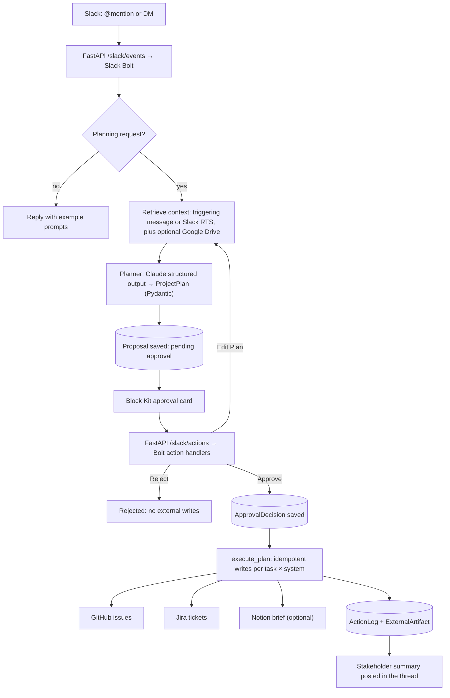

# FlowPilot AI

**A Slack-native project execution copilot.** You describe a project in Slack. FlowPilot drafts a
structured execution plan and posts it as an approval card. Once a human approves, it creates the
tasks in GitHub and/or Jira, writes an audit trail, and posts a summary back to the thread.

Built for the **Slack Agent Builder Challenge 2026**.

```text
Slack request → grounded ProjectPlan → Block Kit approval card → human decision
             → GitHub issues / Jira tickets (+ optional Notion brief) → audit log → Slack summary
```

FlowPilot is not a chatbot, a dashboard, or an autonomous agent. Nothing is written to an external
system until a person clicks **Approve**.

> **Status:** the code paths below are implemented and covered by automated tests, but the
> **live end-to-end demo in a real Slack workspace has not been run yet**. Every external API in
> the test suite is faked. The step-by-step script for that first live run is
> [`docs/runbook.md`](docs/runbook.md).

---

## Feature status

| Area | Status | What the code does |
|---|---|---|
| Slack entry points | Implemented | `@FlowPilot` mentions in channels and direct messages. Messages that don't look like a planning request get a short reply with example prompts. The Slack Assistant panel is **not** supported (no handler). |
| Planning | Implemented | One Claude call with structured output, validated against the `ProjectPlan` Pydantic model (milestones, tasks, risks, dependencies). On validation failure it retries once, then fails safely and saves nothing. |
| Approval card | Implemented | Block Kit card with objective, timeline, counts, the top 3 risks by severity, a GitHub / Jira / Both selector, an optional Notion checkbox, and **Approve / Edit Plan / Reject**. Only the requester or a user in `FLOWPILOT_APPROVER_IDS` can decide, and the first decision wins. |
| GitHub issues | Implemented | One issue per task, idempotent and audited. This is the default target. |
| Jira tickets | Implemented (optional) | Same per-task, idempotent flow. Selected on the card (`Jira` or `Both`). Needs the `JIRA_*` settings. |
| Notion project brief | Implemented (optional) | One brief page per approved plan, linking the created issues/tickets. The checkbox only appears when `NOTION_API_KEY` is set. A Notion failure never affects the GitHub/Jira results. |
| Google Drive context | Implemented (optional, **read-only**) | Searches native Docs/Sheets/Slides with a service account (`drive.readonly` scope, max 5 files, 10 s timeout) and adds them to the planner's context. Nothing from Drive is stored. If Drive fails, planning carries on with Slack context only. |
| Slack context retrieval | Implemented, **off by default** | With `SLACK_RTS_ENABLED=false` (the default) the plan is grounded on the triggering message only. Turning it on calls Slack Real-Time Search (`assistant.search.context`). That path has not been checked against a live RTS-enabled workspace, and it falls back to the triggering message on any error. |
| Risk & stakeholder summary | Implemented, as **one** message | Risks are part of the generated plan, not a separate monitoring service. After execution FlowPilot posts a single summary: created items per system with links, any failed tasks, the Notion brief result, open risks (title + severity), and next steps. There is no progress tracking, recurring report, or risk re-scan after that message. |
| Edit Plan | Implemented (simple) | Re-plans the original objective in the same thread and posts a fresh card. There is no structured edit form. |
| Audit trail | Implemented | Proposals, approval decisions, per-action logs (with idempotency keys) and created artifacts live in Postgres. |
| Health check | Implemented | `GET /health` → `{"status": "ok", "db": "ok" \| "unreachable"}`, always HTTP 200. |
| Docker | Implemented | Backend image plus a local-dev `docker-compose.yml` with Postgres. |
| CI / pre-commit hooks | Not set up | No CI workflow or pre-commit config is committed yet. Run the checks below by hand. |

### Safety guarantees (enforced in code, covered by tests)

- **No external write before approval.** Reject creates nothing. Approve records an
  `ApprovalDecision` before any write, and execution refuses to run unless the proposal is approved.
- **Idempotent writes.** Every (task, target system) pair gets a deterministic idempotency key
  stored in the database. Retries and double clicks don't create duplicate issues, tickets or pages.
- **Partial failures are isolated.** One failed task doesn't stop the rest, and transient HTTP
  failures (429, connection errors) are retried with bounded backoff.
- **Slack messages are never stored or indexed.** Retrieved Slack and Drive context is used for the
  current plan and then discarded. Only derived artifacts (plans, decisions, logs) are persisted.
- **Untrusted text is fenced.** The Slack request and retrieved context go into the prompt as
  delimited data blocks, never as instructions.
- **Slack requests are signature-verified** by Bolt before any handler runs.

---

## Architecture

There is one planner-orchestrator with typed tool adapters, not a multi-agent system. The workflows
are a deterministic state machine written in plain async Python. LangGraph is listed as a dependency
but isn't used by the app code.



Proposal lifecycle: `proposal_pending_approval → {approved | rejected | edit_requested}`, then
`approved → executing → {executed | failed}`.

### Repository layout

```text
backend/
├── app/          FastAPI app (main.py: /health + Slack routes), Pydantic settings, structlog setup
├── slack/        Bolt app, event handlers + intent gate, button/select handlers, Block Kit renderers
├── agents/       ProjectPlan schemas, planner (single Claude call), prompt construction
├── workflows/    create_plan, approve_plan (decision + authorization), execute_plan (idempotent writes)
├── tools/        external adapters: slack_rts, google_drive (read-only), github, jira, notion, retry
├── db/           SQLAlchemy models, repositories, async session, Alembic migrations
├── tests/        pytest suite (no live network: external calls are injected or faked)
├── Dockerfile
└── pyproject.toml / uv.lock
docs/
├── runbook.md               live demo runbook (not yet run)
├── development.md           local development and validation guide
└── slack-app-manifest.yaml  Slack app manifest
docker-compose.yml           local Postgres + backend
```

**Stack:** Python 3.12, uv, FastAPI, Uvicorn, Slack Bolt, Anthropic SDK, Pydantic, SQLAlchemy
(async) + Alembic over PostgreSQL (asyncpg), HTTPX, google-auth, structlog, pytest, ruff, mypy.

---

## Setup and run

You need Python 3.12, [`uv`](https://docs.astral.sh/uv/) (don't use pip, Poetry or Conda),
Postgres (Docker or Supabase), [ngrok](https://ngrok.com/) or another HTTPS tunnel, a Slack
workspace where you can install apps, an Anthropic API key, and a GitHub token with issue write
access to a **throwaway** repo. FlowPilot creates real issues.

### 1. Install dependencies

```bash
cd backend
uv sync
```

### 2. Configure environment variables

Copy the template `backend/.env.example` to `backend/.env` (gitignored) and fill it in, or export
the variables in your shell. Settings load from `.env` in the current directory, so run commands
from `backend/`. Variable names are the `Settings` fields in `backend/app/config.py`, upper-cased.
Never commit or log real values.

Required (the app won't start without them):

- `SLACK_BOT_TOKEN`, `SLACK_SIGNING_SECRET`
- `ANTHROPIC_API_KEY`
- `DATABASE_URL` (must use the `postgresql+asyncpg://` scheme)
- `GITHUB_TOKEN`, `GITHUB_OWNER`, `GITHUB_REPO`

Optional:

| Variable(s) | Default | Purpose |
|---|---|---|
| `DEFAULT_MODEL_NAME` | `claude-sonnet-5` | Claude model used by the planner |
| `DEFAULT_MODEL_PROVIDER` | `anthropic` | Read into settings, but only Anthropic is implemented |
| `DEFAULT_TARGET_SYSTEM` | `github` | Card's initial target: `github`, `jira` or `both` |
| `JIRA_BASE_URL`, `JIRA_EMAIL`, `JIRA_API_TOKEN`, `JIRA_PROJECT_KEY` | unset | Jira target |
| `NOTION_API_KEY`, `NOTION_PARENT_PAGE_ID`, `DEFAULT_NOTION_ENABLED` | unset / `false` | Notion project brief |
| `GOOGLE_DRIVE_CREDENTIALS`, `GOOGLE_DRIVE_FOLDER_SCOPE`, `DEFAULT_GOOGLE_DRIVE_ENABLED` | unset / `false` | Drive context. The credentials value is the service-account JSON **content**, not a file path |
| `SLACK_RTS_ENABLED` | `false` | Live Slack Real-Time Search (also needs the RTS scopes that are commented out in the manifest) |
| `FLOWPILOT_APPROVER_IDS` | empty | Comma-separated Slack user IDs that may decide on any plan (the requester always can) |
| `LOG_LEVEL` | `INFO` | |

### 3. Database and migrations

```bash
docker compose up -d db          # from the repo root; skip if you use Supabase or your own Postgres
cd backend
uv run alembic upgrade head
```

With the compose database, use the `DATABASE_URL` shown in the header comment of
`docker-compose.yml`.

### 4. Run the API

```bash
cd backend
uv run uvicorn app.main:app --reload    # http://localhost:8000
curl -s localhost:8000/health           # expect {"status":"ok","db":"ok"}
```

### 5. Expose it and create the Slack app

```bash
ngrok http 8000
```

1. At api.slack.com/apps choose **Create New App → From a manifest** and paste
   [`docs/slack-app-manifest.yaml`](docs/slack-app-manifest.yaml).
2. Copy the **Signing Secret** and, after installing the app, the **Bot User OAuth Token** into
   your env vars, then restart the API.
3. Set **Event Subscriptions** to `https://<ngrok-host>/slack/events` and **Interactivity** to
   `https://<ngrok-host>/slack/actions`. The server has to be running so Slack can verify the URL.
4. Invite the bot to a channel and post, for example:
   `@FlowPilot launch our customer onboarding redesign in four weeks.`

The full demo script, SQL audit checks and troubleshooting table are in
[`docs/runbook.md`](docs/runbook.md).

---

## Tests and quality checks

Run everything from `backend/`. These are the checks a change has to pass:

```bash
uv run ruff check .
uv run ruff format --check .
uv run mypy .
uv run pytest -q
```

The suite needs no network, no Slack workspace and no Postgres. Tests use in-memory SQLite and
injected fakes for every external call.

Coverage runs automatically: `uv run pytest` prints a per-file report with missing lines for
`app`, `slack`, `agents`, `workflows`, `tools` and `db` (configured in `backend/pyproject.toml`).
There's no minimum threshold.

More detail (what each test file covers, how to validate each integration by hand) is in
[`docs/development.md`](docs/development.md).

---

## Docker

```bash
# Postgres + backend (the image runs `alembic upgrade head` before starting uvicorn)
docker compose up --build

# or build and run the backend image on its own
docker build -f backend/Dockerfile -t flowpilot-ai-backend backend
docker run -p 8000:8000 --env-file backend/.env flowpilot-ai-backend
```

The image is built with uv, runs as a non-root user, and needs no secrets at build time. All
configuration comes in as env vars at run time. Compose is for local development only: both ports
bind to `127.0.0.1`, and it isn't a production deployment.

---

## Documentation

- [`docs/runbook.md`](docs/runbook.md): live Slack demo, step by step (not yet run)
- [`docs/development.md`](docs/development.md): local development, checks, per-integration validation
- [`docs/slack-app-manifest.yaml`](docs/slack-app-manifest.yaml): Slack app configuration

## License

MIT. See [`LICENSE`](LICENSE). Owners: Ajitkumar Senthil Kumar and Sruthisri Venkateswaran.
