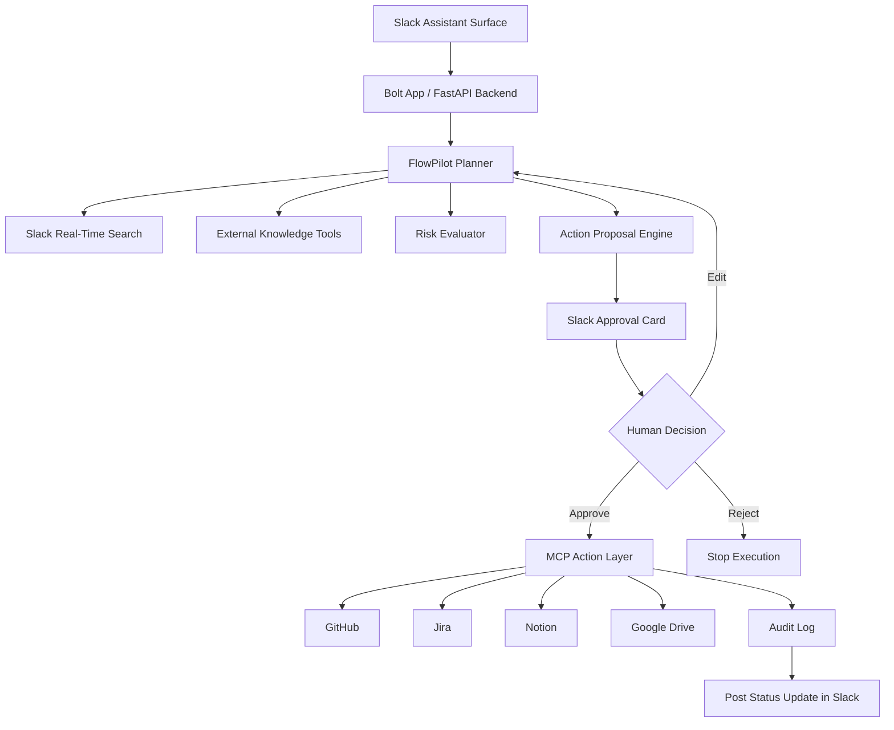

# FlowPilot AI

### Slack-Native Project Execution Copilot

> Turn messy Slack discussions into approved execution plans, tracked tasks, risk alerts, and stakeholder updates.

FlowPilot AI is a Slack-native AI agent that helps teams move from discussion to execution without leaving Slack. It reads project context from Slack using permission-aware Real-Time Search, drafts an execution plan, asks for human approval, creates tasks through MCP-connected tools, and keeps stakeholders updated as work progresses.

Built for the **Slack Agent Builder Challenge 2026**.

---

## Why FlowPilot AI?

Teams do not usually fail because they lack ideas. They slow down because execution context is scattered.

A single project request like:

```text
Launch the new customer onboarding redesign in four weeks.
```

quickly becomes fragmented across:

* Slack threads
* Jira tickets
* GitHub issues
* Notion docs
* Google Drive files
* Status meetings
* Stakeholder messages

FlowPilot AI turns that scattered context into a structured execution workflow inside Slack.

---

## What FlowPilot Does

FlowPilot is not a generic chatbot.

It is a project execution agent that follows a safe, human-in-the-loop workflow:

```text
Slack request
   ↓
Retrieve relevant Slack context
   ↓
Generate execution plan
   ↓
Show approval card
   ↓
Create or update tasks through MCP
   ↓
Track progress and risks
   ↓
Post stakeholder updates
```

---

## Core Demo Workflow

### User request

```text
@FlowPilot launch our customer onboarding redesign in four weeks.
```

### FlowPilot retrieves context

FlowPilot searches relevant Slack conversations and files using Slack Real-Time Search.

It finds:

* Previous onboarding discussions
* Existing project decisions
* Open risks
* Mentioned stakeholders
* Related implementation notes

### FlowPilot proposes a plan

FlowPilot generates:

* Milestones
* Deliverables
* Task breakdown
* Owners
* Dependencies
* Risks
* Suggested timeline

### Human approval

Before making external changes, FlowPilot shows an approval card in Slack:

```text
Proposed Execution Plan

Milestones: 4
Tasks: 11
Open Risks: 3
External Actions: Create GitHub issues

[Approve] [Edit Plan] [Reject]
```

### FlowPilot executes approved actions

After approval, FlowPilot can:

* Create GitHub issues
* Create Jira tickets
* Update Notion documentation
* Post stakeholder summaries
* Maintain an execution audit log

---

## Key Features

### 1. RTS-Grounded Planning

FlowPilot uses Slack Real-Time Search to retrieve fresh, permission-aware workspace context before planning.

This keeps plans grounded in real project conversations instead of generic LLM assumptions.

---

### 2. Human-in-the-Loop Approval

FlowPilot separates planning from execution.

Read-only operations can run automatically, but write actions require user approval.

Examples of gated actions:

* Creating GitHub issues
* Creating Jira tickets
* Updating Notion docs
* Posting stakeholder announcements
* Changing project status

---

### 3. MCP-Based Tool Execution

FlowPilot connects to external systems through MCP-compatible tools.

Supported or planned integrations:

* GitHub
* Jira
* Notion
* Google Drive
* Slack MCP server
* Internal APIs

---

### 4. Risk Detection

FlowPilot identifies execution risks such as:

* Missing owners
* Unclear requirements
* Delayed milestones
* Blocked dependencies
* Unanswered stakeholder questions
* Scope creep

---

### 5. Automated Stakeholder Reporting

FlowPilot can generate:

* Daily updates
* Weekly status reports
* Executive summaries
* Risk summaries
* Project health assessments

Example:

```text
Weekly Project Summary

Progress: 72%
Open Risks: 3
Blocked Tasks: 1
Expected Completion: On Track

Top Risk:
Design approval is still pending and may affect engineering start date.
```

---

### 6. Audit Log and Idempotent Actions

Every proposed and approved action is logged.

FlowPilot tracks:

* Proposed action
* Evidence used
* Approval decision
* External system target
* Idempotency key
* Execution result
* Timestamp

This makes agent actions reviewable, traceable, and safer for enterprise workflows.

---

## Architecture



---

## Agent Design

FlowPilot uses a lean agent architecture focused on reliability.

Instead of a broad multi-agent supervisor, the MVP uses one planner-orchestrator with typed tools.

### Planner-Orchestrator Responsibilities

* Understand the project request
* Retrieve relevant Slack context
* Generate a structured execution plan
* Identify risks and dependencies
* Propose external actions
* Request human approval
* Execute approved actions
* Produce stakeholder updates

### Tool Types

| Tool Type       | Purpose                                                   |
| --------------- | --------------------------------------------------------- |
| Retrieval tools | Search Slack and connected project knowledge              |
| Planning tools  | Convert goals into milestones and tasks                   |
| Risk tools      | Detect blockers, missing owners, and timeline risks       |
| Action tools    | Create or update GitHub, Jira, Notion, or Slack artifacts |
| Reporting tools | Generate project summaries and stakeholder updates        |

---

## Slack-Native Capabilities

FlowPilot is designed around Slack-native agent primitives.

| Capability              | Usage                                                |
| ----------------------- | ---------------------------------------------------- |
| Slack Assistant Surface | Main conversational interface                        |
| Slack Events API        | Receives mentions, DMs, and assistant events         |
| Bolt SDK                | Slack app framework                                  |
| Real-Time Search API    | Retrieves permission-aware Slack context             |
| MCP                     | Executes actions across external systems             |
| Block Kit               | Renders plans, approval cards, alerts, and summaries |
| Streaming Responses     | Shows progress while FlowPilot works                 |
| Suggested Prompts       | Guides users toward high-value workflows             |

---

## Technology Stack

### Slack

* Slack Events API
* Slack Bolt SDK
* Slack Assistant surface
* Slack Real-Time Search API
* Block Kit
* Slack MCP server

### AI Layer

* Python agent runtime
* OpenAI / Anthropic models
* Structured tool calling
* Retrieval-augmented planning
* Human-in-the-loop execution

### Backend

* FastAPI
* PostgreSQL / Supabase
* SQLAlchemy or equivalent ORM
* Pydantic validation
* Background jobs for reporting

### Integrations

* GitHub MCP tools
* Jira MCP tools
* Notion MCP tools
* Google Drive tools
* Internal APIs

### Infrastructure

* Docker
* GitHub Actions
* Cloud deployment
* Environment-based configuration
* Observability and audit logging

---

## Security and Data Model

FlowPilot is designed with enterprise safety in mind.

### Slack Context

* Slack context is retrieved through Slack Real-Time Search.
* FlowPilot does not build a custom vector database of Slack messages.
* Slack data is used only for the active user request.
* Access follows Slack workspace permissions.

### External Data

FlowPilot may store metadata for its own workflow state:

* Project plans
* Approved action payloads
* Audit log entries
* Integration IDs
* Execution results
* User approval decisions

### Write Safety

FlowPilot uses a plan-approve-apply model:

1. Generate proposal
2. Render approval card
3. Wait for human confirmation
4. Execute approved action
5. Verify result
6. Log the outcome

---

## Example Project Plan Output

```text
Project: Customer Onboarding Redesign
Timeline: 4 weeks
Status: Planning

Milestone 1: Requirements Alignment
- Confirm onboarding goals
- Review customer feedback
- Identify success metrics

Milestone 2: Design Finalization
- Create updated onboarding flow
- Review with product and design
- Approve final UX copy

Milestone 3: Engineering Implementation
- Create frontend tasks
- Create backend/API tasks
- Add analytics events

Milestone 4: QA and Launch
- Run QA checklist
- Prepare launch notes
- Post stakeholder update

Open Risks:
- Design approval is not assigned
- Analytics requirements are unclear
- Launch timeline may be tight if QA slips
```

---

## Planned Repository Structure

```text
flowpilot-ai/
├── app/
│   ├── main.py
│   ├── config.py
│   └── server.py
│
├── slack/
│   ├── assistant.py
│   ├── events.py
│   ├── blocks.py
│   └── handlers.py
│
├── agents/
│   ├── planner.py
│   ├── risk.py
│   ├── reporter.py
│   └── schemas.py
│
├── tools/
│   ├── slack_rts.py
│   ├── github.py
│   ├── jira.py
│   ├── notion.py
│   └── mcp.py
│
├── workflows/
│   ├── plan_project.py
│   ├── approve_action.py
│   └── generate_report.py
│
├── db/
│   ├── models.py
│   ├── migrations/
│   └── repository.py
│
├── tests/
│   ├── test_planner.py
│   ├── test_risk.py
│   └── test_actions.py
│
├── docker-compose.yml
├── Dockerfile
├── README.md
└── .env.example
```

---

## Environment Variables

```bash
SLACK_BOT_TOKEN=
SLACK_SIGNING_SECRET=
SLACK_APP_TOKEN=

OPENAI_API_KEY=
ANTHROPIC_API_KEY=

DATABASE_URL=
SUPABASE_URL=
SUPABASE_SERVICE_ROLE_KEY=

GITHUB_TOKEN=
JIRA_API_TOKEN=
NOTION_API_KEY=

MCP_SERVER_URL=
APP_BASE_URL=
```

---

## Getting Started

### 1. Clone the repository

```bash
git clone https://github.com/your-org/flowpilot-ai.git
cd flowpilot-ai
```

### 2. Create environment file

```bash
cp .env.example .env
```

Fill in the required Slack, model, database, and integration credentials.

### 3. Start the backend

```bash
docker compose up --build
```

### 4. Install the Slack app

Create and install a Slack app with the required bot scopes, event subscriptions, and assistant permissions.

### 5. Run the agent

Mention FlowPilot in Slack:

```text
@FlowPilot create an execution plan for our onboarding redesign launch.
```

---

## MVP Scope

The MVP focuses on one high-value workflow:

> Turn a Slack project discussion into an approved execution plan and create the corresponding GitHub or Jira tasks.

### Included in MVP

* Slack Assistant interaction
* RTS-grounded project context retrieval
* Structured execution planning
* Risk detection
* Block Kit approval cards
* GitHub or Jira task creation
* Stakeholder status summary
* Audit logging

### Not Included in MVP

* Autonomous task ownership
* Long-term Slack message indexing
* Fully autonomous external writes
* Multi-project portfolio optimization
* Enterprise admin dashboard
* Predictive resource planning

---

## Roadmap

### v1 — Challenge MVP

* Slack-native project planning
* RTS-grounded context retrieval
* Human approval cards
* GitHub/Jira task creation
* Weekly status reporting
* Action audit log

### v2 — Team Execution Layer

* Multi-project tracking
* Recurring risk scans
* Notion and Drive synchronization
* Project memory summaries
* Team-level reporting

### v3 — Autonomous Execution Intelligence

* Predictive delivery risk
* Resource planning recommendations
* Cross-project dependency detection
* Self-healing workflows
* Organization-wide execution memory

---

## Evaluation Metrics

FlowPilot can be evaluated using:

| Metric                  | Description                                           |
| ----------------------- | ----------------------------------------------------- |
| Plan acceptance rate    | Percentage of generated plans approved by users       |
| Action approval rate    | Percentage of proposed actions approved               |
| Edit rate               | How often users modify generated plans                |
| Time saved              | Estimated reduction in manual planning/reporting time |
| Risk detection accuracy | Quality of identified blockers and dependencies       |
| Task creation success   | Percentage of approved tasks created successfully     |
| User feedback           | Slack feedback button responses                       |

---

## Why This Matters

Most workplace AI tools answer questions.

FlowPilot helps teams execute.

It combines:

* Slack-native context
* Structured planning
* Safe tool execution
* Human approval
* Risk tracking
* Stakeholder communication

The result is a practical execution agent that makes Slack not just a place where work is discussed, but a place where work is coordinated and moved forward.

---

## Team

### AI Architecture Lead

Owns agent design, planning workflows, retrieval strategy, risk reasoning, and tool orchestration.

### Product & Platform Lead

Owns Slack experience, backend services, integrations, deployment, and production infrastructure.

---

## Built For

**Slack Agent Builder Challenge 2026**

FlowPilot AI leverages:

* Slack AI app surfaces
* Slack Real-Time Search
* MCP integrations
* Block Kit interaction patterns

to build a safer, more execution-focused workplace agent.

---

## License

MIT License. 
OWNERS: 
- AJITKUMAR SENTHIL KUMAR
- SRUTHISRI VENKATESWARAN
